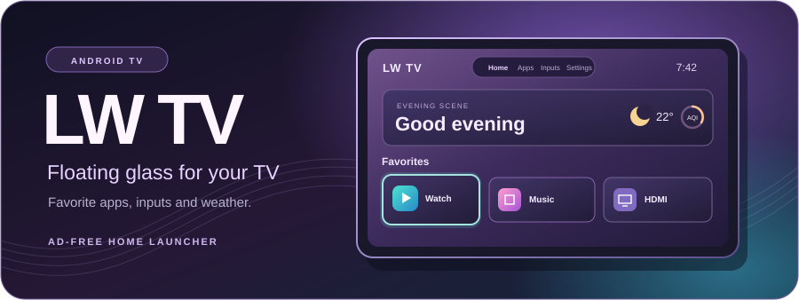
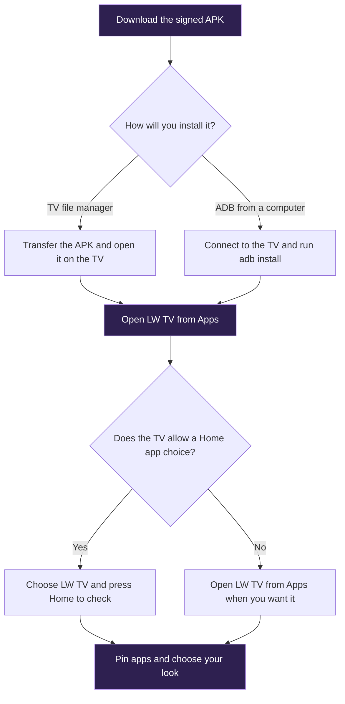

<p align="center">
  
</p>

<p align="center">
  <a href="https://github.com/lakshaywalia666/LW-TV/releases/download/v3.0.1/LW-TV-3.0.1.apk"><strong>Download LW TV 3.0.1</strong></a>
  · <a href="https://github.com/lakshaywalia666/LW-TV/releases/latest">Release notes and checksum</a>
  · <a href="#install-on-your-tv">Installation guide</a>
</p>

LW TV is an ad-free home launcher for Android TV. Its floating glass cards put your favorite apps, HDMI inputs, weather and settings within reach of the remote.

## Make it yours

| Feature | What you can do |
| --- | --- |
| Floating glass | Lift and tilt the selected card. Its icon rises above the glass while a reflection sweeps across it and the wallpaper shifts with focus. |
| Scene design | Choose from five color themes, three glass finishes and four wallpapers. Adjust depth, icon size, ambient glow and motion, or let scene lighting follow the time of day. |
| Favorites and inputs | Reorder favorites with the D-pad, jump to HDMI inputs, and give each input a name and device symbol. |
| Weather and air quality | See the temperature and an Indian AQI estimate, then open the card for a 24-hour trend, pollutant readings and model time. |
| Screensaver | Choose Floating Digital, Glass Analog or Aurora Clock. The screensaver starts after 30 minutes on Home by default. |

## Install on your TV

LW TV targets Android TV and Google TV devices running Android 6.0 or newer. The launcher was developed on a Redmi TV with Android 11. Home selection and HDMI availability depend on the device firmware.



### Option 1 · Install from the TV

1. Download `LW-TV-3.0.1.apk` from [GitHub Releases](https://github.com/lakshaywalia666/LW-TV/releases/latest).
2. Copy it to a USB drive or use a file transfer app to send it to your TV.
3. Open the APK in the TV’s file manager. If prompted, allow **Install unknown apps** for that file manager, then confirm the installation.
4. Open **LW TV** from the TV’s Apps screen.

### Option 2 · Install with ADB

1. Install [Android SDK Platform Tools](https://developer.android.com/tools/releases/platform-tools) on your computer. Open a terminal in the folder containing the APK and make sure `adb` is on your PATH.
2. Enable **Developer options** on the TV, then choose the debugging mode available on your model. Connect the computer and TV to the same network for wireless debugging.
3. If the TV offers **Wireless debugging → Pair device with pairing code**, use the addresses and ports displayed on the TV. The pairing port and debugging port can differ.

   ```sh
   adb pair TV_IP:PAIRING_PORT
   adb connect TV_IP:DEBUG_PORT
   ```

   For a TV with a **Network debugging** option, connect to the address and port displayed there. For a device with USB debugging, connect the USB data cable and authorize the computer on the TV.

4. Verify the connection, install the APK and open LW TV.

   ```sh
   adb devices
   adb install -r LW-TV-3.0.1.apk
   adb shell am start -n com.zerotv.next/.MainActivity
   ```

   If more than one device appears, put `-s DEVICE_SERIAL` after `adb` in the install and launch commands. Use the serial shown by `adb devices`. See the [Android debugging guide](https://developer.android.com/tools/adb) for connection help.

### Set LW TV as Home

Open **LW TV → Settings → Default Home app** and select **LW TV** if your TV offers the chooser. Press **Home** to verify. To switch back, select your previous launcher in the same menu.

<details>
<summary>Set or restore Home with ADB on supported firmware</summary>

Save the final line printed by the first command so you can restore your previous Home component later.

```sh
adb shell cmd package resolve-activity --brief -a android.intent.action.MAIN -c android.intent.category.HOME
adb shell cmd package set-home-activity com.zerotv.next/.MainActivity
adb shell input keyevent KEYCODE_HOME
```

To restore Home, replace `PREVIOUS_HOME_COMPONENT` with the component you saved.

```sh
adb shell cmd package set-home-activity PREVIOUS_HOME_COMPONENT
adb shell input keyevent KEYCODE_HOME
```

If the TV rejects Home selection, you can still use LW TV from **Apps**.

</details>

## Remote controls

| Where | Action |
| --- | --- |
| Home | Hold **OK** on a favorite, move it with the arrows, then press **OK** to save or **Back** to cancel. |
| All apps | Hold **OK** to pin or unpin an app or open its Android app info. |
| Any tab | Press **Menu** or select **≡** beside the clock to open Quick settings. |
| Inputs | Hold **OK** on an HDMI card to rename it or choose a device symbol. |
| Settings | Adjust the scene, set a greeting or choose **Weather location** to enter a place name and decimal coordinates. |
| Screensaver | Open **Menu → Screensaver** to choose a clock, change the delay or preview it. Press a direction or **OK** to return. |

## Weather and privacy

The weather card starts with New Delhi and uses the location you enter in **Settings → Weather location**. LW TV stores preferences on the TV. Weather requests send the selected coordinates to Open-Meteo over HTTPS. Turn off **Weather on Home** to stop weather refreshes.

The AQI uses CPCB breakpoints and CAMS model concentrations for PM2.5, PM10, NO₂, SO₂, CO and ozone. It is a regional model estimate at approximately 45 km resolution. The weather panel’s **Data source and licence** option lists the attribution. [CPCB methodology](https://airquality.cpcb.gov.in/ccr_docs/FINAL-REPORT_AQI_.pdf) · [Open-Meteo air quality data](https://open-meteo.com/en/docs/air-quality-api)

## Build from source

The app uses native Java and Android resources. Build on Windows with PowerShell 7, JDK 17 or newer, Android SDK Platform 34 or newer and Android SDK Build-Tools.

```powershell
git clone https://github.com/lakshaywalia666/LW-TV.git
cd LW-TV
.\build.ps1
```

The build writes `dist/LW-TV-local.apk` and creates a local signing key on the first run. Keep your local signing files if you want to update that build later. Use GitHub release APKs when updating an installed GitHub release.

To check a download on Windows, compare its hash with `SHA256SUMS.txt` from the release.

```powershell
Get-FileHash .\LW-TV-3.0.1.apk -Algorithm SHA256
```

LW TV is an independent launcher. App names and logos identify the corresponding apps.
